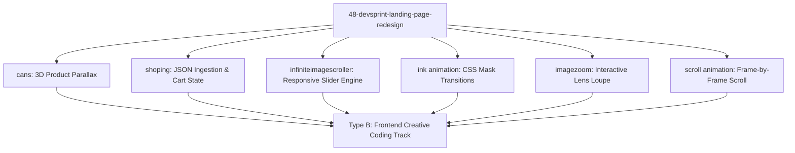

# Project Type Pre-Check: 48-DevSprint-Landing-Page-Redesign

## Step 0 Pre-Check Analysis

- **Detected Track**: **Track B: Frontend Only (Creative Coding, Interactive Micro-Experiences & Motion Lab)**
- **Project Root**: `/Users/avishjain/avishjain9-repos/48-devsprint-landing-page-redesign`
- **Application Modules**:
  1. `cans/`: 3D parallax scroll product showcase.
  2. `shoping/`: Dynamic e-commerce storefront with JSON data ingestion and LocalStorage cart state.
  3. `infiniteimagescroller/`: Infinite carousel slider with dot pagination and responsive resize recalculation.
  4. `ink animation/`: Masking and ink transition animations.
  5. `imagezoom effect/`: Interactive cursor magnifying loupe.
  6. `scroll animation/`: Scroll-driven image sequence playback.

