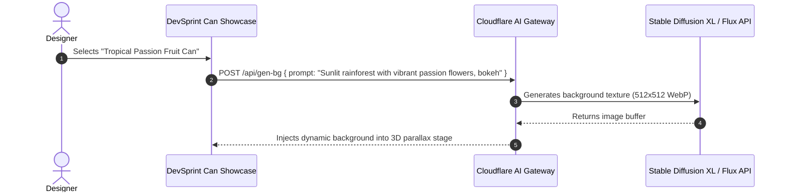

# AI Integration Analysis: DevSprint Motion Lab

## Current Status: No AI Integration

The repository contains **No AI integration**.

---

## Architectural Blueprint: Generative AI Dynamic Backgrounds & Smart Product Re-Styler

