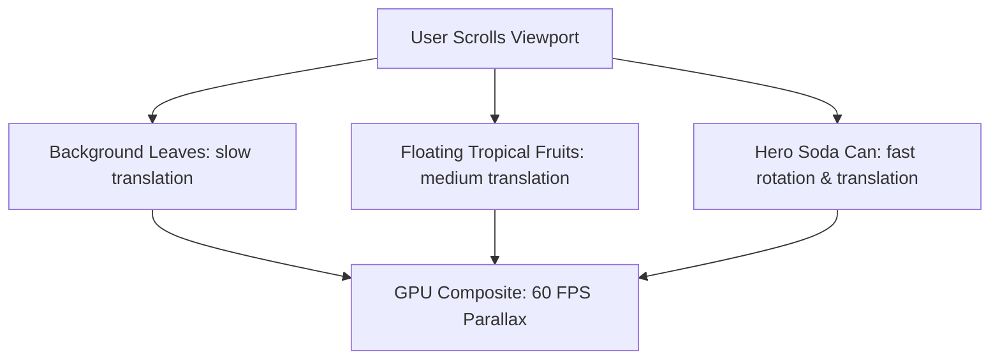

# F1: 3D Parallax Product Staging

## Overview & Architecture
An immersive 3D soda can presentation stage in `cans/` leveraging CSS 3D perspective and multi-layer depth coordinates.

## Say It Out Loud
> "In the `cans/` module, I built a 3D product showcase using pure CSS 3D transforms. The stage is separated into three visual depth planes: ambient background foliage, floating fruits, and the primary soda can. As the user scrolls, each layer translates at a distinct velocity ratio, creating an organic feeling of depth without using any heavy 3D canvas libraries."
