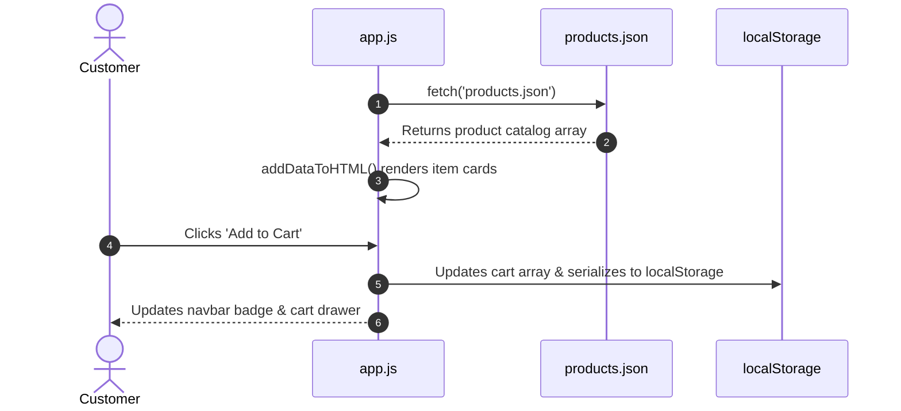

# F2: Dynamic JSON E-Commerce Storefront & Cart

## Overview & Architecture
Client-side e-commerce storefront in `shoping/app.js` asynchronously parsing `products.json` and managing cart state in `localStorage`.

## Say It Out Loud
> "In `shoping/app.js`, I engineered a lightweight client-side shopping application. The script boots by fetching a local `products.json` file, dynamically populates the product grid, and initializes the cart from `localStorage`. When shoppers add items or toggle quantities, the model updates immutably, recalculates totals, and syncs to browser storage with zero page flickering."
